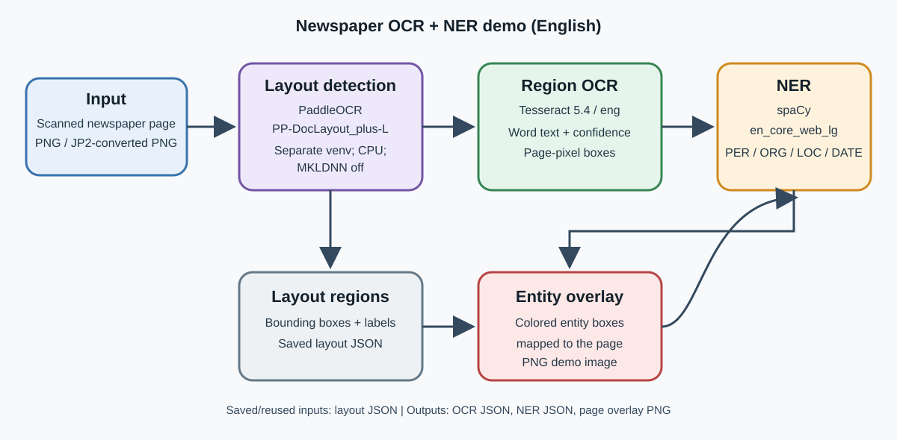

# Named Entity Recognition from Newspaper Images

An English command-line prototype for finding **people (PER), organizations
(ORG), locations (LOC), and dates (DATE)** in scanned newspaper pages. The
pipeline detects layout regions, runs OCR, applies NER, maps predictions back to
page pixels, and writes JSON plus an entity overlay image.

**Course task:** Named Entity Recognition from Image Documents\
**Repository:** https://github.com/rishoct26/newspaper-ner\
**Status:** English development demo complete; multilingual validation remains future work.

> Current development scans are historical US newspapers. The results do not
> establish performance on current Indian English, Hindi, or Odia newspapers.

## Submission materials

- [Editable report source (Markdown)](docs/project_report.md)
- A locally generated PDF copy is available at `docs/project_report.pdf`; it contains scan-derived figures and is not included in Git pending item-specific rights review.
- [Pipeline diagram](docs/newspaper_ner_pipeline.svg)
- [OCR evaluation rules](docs/evaluation.md)
- [NER annotation rules](docs/ner_annotation.md)
- [Detailed development progress log](docs/progress_report.md)

The group must add member names, roll numbers, actual contributions, and an
accessible recording link before submission. No slide deck or video recording
is included in this repository version. Sample scans and image-derived outputs
are prepared locally but remain uncommitted pending review of the source rights
recorded in `data/en_dev_sources.csv`.

## Pipeline



1. **Layout:** PaddleOCR `PP-DocLayout_plus-L` detects page elements and boxes.
2. **OCR:** Tesseract recognizes words inside text-bearing regions and stores
   OCR confidence, Tesseract line IDs, and page-pixel bounding boxes.
3. **NER:** spaCy `en_core_web_lg` predicts PER, ORG, LOC, and DATE and aligns
   each entity to OCR words.
4. **Overlay:** Pillow draws class-colored boxes over the original page.

OCR and NER confidence are separate. The current spaCy entity interface does
not provide calibrated entity confidence, so `ner_confidence` is `null`; the
output retains OCR confidence for the words forming each entity.

## How to run

### Windows prerequisites

- Python 3.13 (the tested version is 3.13.13).
- Tesseract OCR 5.4 with the English `eng` language data. The tested Windows
  path is `C:\Program Files\Tesseract-OCR\tesseract.exe`.
- A separate Paddle environment for first-time layout inference: PaddlePaddle
  3.3.1 and PaddleOCR 3.7.0. The demo calls it automatically with CPU inference
  and MKLDNN disabled.

Create the main environment and install this project from PowerShell at the
repository root:

```powershell
py -3.13 -m venv .venv
.\.venv\Scripts\Activate.ps1
python -m pip install -e .
$env:TESSERACT_CMD = "C:\Program Files\Tesseract-OCR\tesseract.exe"
```

Create the separate layout environment once on a new machine:

```powershell
py -3.13 -m venv .venv\layout-check
.\.venv\layout-check\Scripts\python.exe -m ensurepip --upgrade
.\.venv\layout-check\Scripts\python.exe -m pip install paddlepaddle==3.3.1 paddleocr==3.7.0
```

Run the one-command Cordele development demo:

```powershell
python -m newspaper_ner.demo "scans\en_dev\en_cordele-dispatch_1926-11-09_p01.png" --output-dir "outputs\cordele-submission-demo"
```

The command prints stage timings, counts, an entity-label table, the top entity
predictions, and output paths. It reuses a saved layout JSON if it matches the
input page; otherwise it invokes PaddleOCR automatically. For the current demo,
the saved layout is `outputs/layout-only/layout.json`.

Outputs are written to:

```text
outputs/cordele-submission-demo/ocr.json
outputs/cordele-submission-demo/ner.json
outputs/cordele-submission-demo/entities.png
```

To view them in VS Code:

```powershell
code outputs\cordele-submission-demo\entities.png
code outputs\cordele-submission-demo\ocr.json
code outputs\cordele-submission-demo\ner.json
```

### Other commands

Run OCR on an image without layout detection:

```powershell
newspaper-ner "scans\en_dev\en_cordele-dispatch_1926-11-09_p01.png" --language en --psm 6 -o "outputs\cordele-p01-ocr.json"
```

Run NER on an OCR JSON, then score against a gold annotation:

```powershell
newspaper-ner-entities "outputs\cordele-body-region-ocr.json" -o "outputs\cordele-body-ner.json"
newspaper-ner-score "outputs\cordele-body-ner.json" "data\annotations\en_cordele_body_ner_gold.json" -o "outputs\cordele-body-ner-evaluation.json"
```

Compare clean reference text and OCR text on the English development regions:

```powershell
python -m newspaper_ner.comparison --input-dir outputs --output outputs\ner-dev-comparison.json --model en_core_web_lg
```

Rebuild the PDF report with ReportLab 4.4.9 available in the Python environment:

```powershell
python -m pip install -r requirements-report.txt
python scripts\render_project_report.py
```

## Development results

The NER comparison used 24 English development regions and 148 manually checked
gold mentions. It used exact entity text and label matching, no post-processing
rules, and spaCy 3.8.18. The 95% intervals use 1,000 region-bootstrap samples.

| Model | NER input | Exact F1 | 95% region-bootstrap interval |
| --- | --- | ---: | ---: |
| `en_core_web_lg` 3.8.0 | Verified reference text | 74.2% | 63.7-84.3% |
| `en_core_web_lg` 3.8.0 | OCR text | 58.0% | 49.7-65.8% |

On one Cordele article-body crop, OCR with line-end hyphens joined scored CER
0.27% (1 edit / 370 reference characters) and WER 1.49% (1 edit / 67 reference
words). These are small development-region results, not estimates of
general-purpose accuracy. The full detailed tables, settings, and limitations
are in the [project report](docs/project_report.pdf).

## Models and data sources

- Layout model: [PaddleOCR `PP-DocLayout_plus-L` documentation](https://www.paddleocr.ai/main/en/version3.x/module_usage/layout_detection.html).
- OCR: [Tesseract 5.x manual](https://tesseract-ocr.github.io/tessdoc/).
- NER: [spaCy English model documentation](https://spacy.io/models/en#en_core_web_lg).
- Development scan: [Library of Congress, *The Cordele Dispatch*, 9 November 1926](https://www.loc.gov/item/2022239700/1926-11-09/ed-1/).
- Collection information: [Chronicling America](https://www.loc.gov/collections/chronicling-america/about-this-collection/).

The manifest is `data/en_dev_sources.csv`. Some source rights are marked
`unknown`. The project claims no ownership of newspaper text or images; all
rights remain with their respective rights holders. The scans were accessed
through Library of Congress Chronicling America and Internet Archive records
for research and educational work. Access through either service does not by
itself grant permission to redistribute an item. The Library of Congress
states that users are responsible for assessing rights for individual items
([Chronicling America rights and access](https://www.loc.gov/collections/chronicling-america/about-this-collection/rights-and-access/));
Internet Archive likewise does not guarantee item copyright status and requires
users to ensure their use is lawful ([Internet Archive rights notice](https://archivesupport.zendesk.com/hc/en-us/articles/360014759692-Rights)).
This notice is not a license or a legal determination. Full scans and
scan-derived sample assets are kept out of Git unless item-specific reuse
rights are verified. The repository keeps model weights, caches, secrets, and
generated outputs out of Git. `sources/` is treated as read-only.

## Repository map

```text
data/annotations/       Manually checked development gold annotations
docs/                   Evaluation rules, pipeline diagram, report source/PDF
scripts/                Download, conversion, layout helper, report renderer
tests/                  OCR/evaluation unit tests
work/newspaper_ner/     OCR, NER, evaluation, overlay, and demo modules
scans/                  Local source images; excluded from Git
models/                 Local model data; excluded from Git
outputs/                Local run outputs/caches; excluded from Git
samples/                Local downscaled demo assets; rights review pending
```

## Scope and next work

The working end-to-end demo is English-only. Hindi OCR support exists in the
OCR layer, but Hindi NER has not been implemented or evaluated. Odia has not
been added. The working end-to-end demo is English-only. Hindi OCR support exists in the
OCR layer, but Hindi NER has not been implemented or evaluated. Odia has not
been added.Further development will build a robust multilingual pipeline by adding Hindi and Odia support, expanding and validating datasets, and strengthening evaluation across diverse newspaper sources and layouts.
